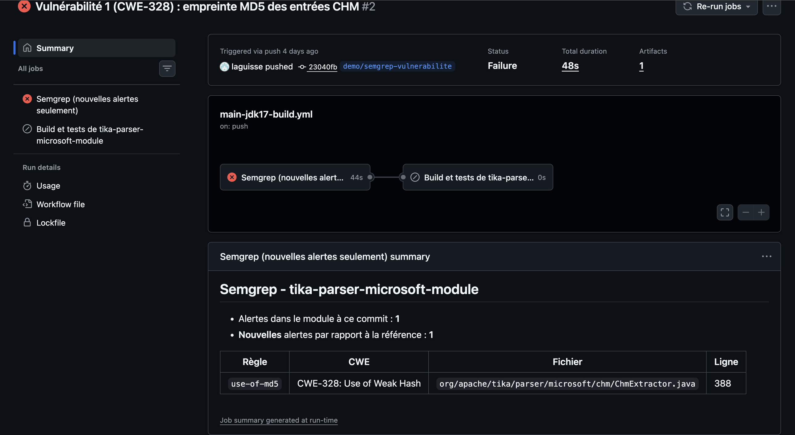
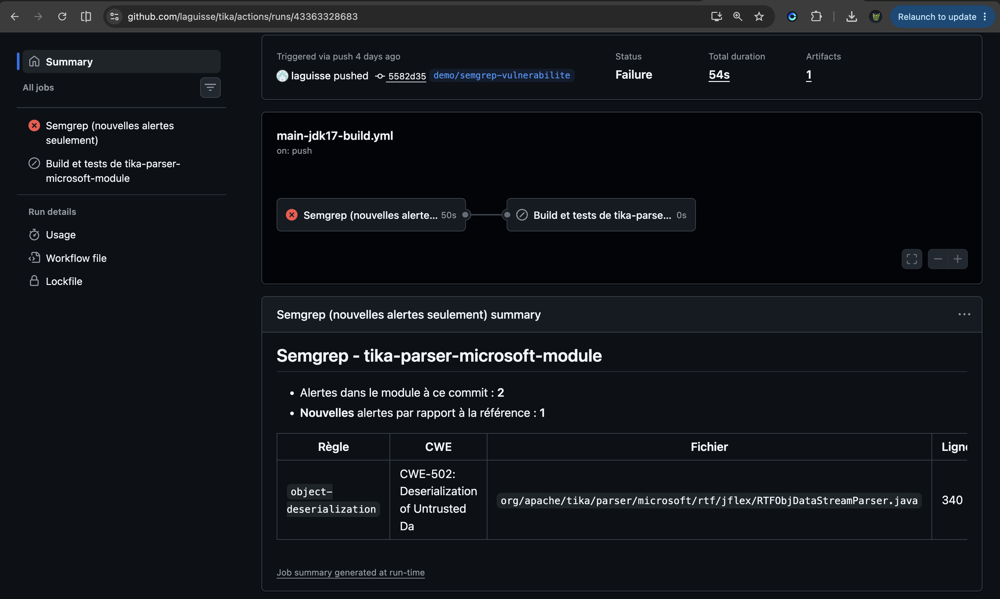
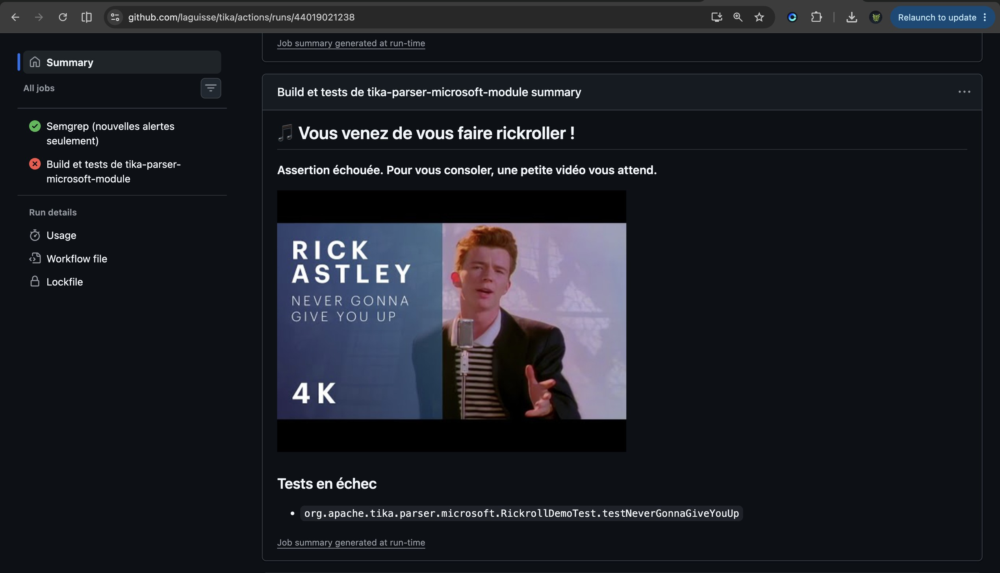

# IFT3913 – Tâche 3 : Semgrep dans le CI, vulnérabilités et rickroll

**Binôme :** Nourdin Azami – Taha Azami
**Dépôt :** <https://github.com/laguisse/tika> (fork de `umontreal-diro/tika`)
**Module étudié :** `tika-parsers/tika-parsers-standard/tika-parsers-standard-modules/tika-parser-microsoft-module`

## Sommaire

1. [Vue d'ensemble](#1-vue-densemble)
2. [Modification du workflow GitHub Actions](#2-modification-du-workflow-github-actions)
3. [Validation du workflow](#3-validation-du-workflow)
4. [Les 7 vulnérabilités introduites](#4-les-7-vulnérabilités-introduites)
5. [Comparaison des rapports Semgrep avant / après](#5-comparaison-des-rapports-semgrep-avant--après)
6. [Rickroll quand un test échoue](#6-rickroll-quand-un-test-échoue)
7. [Limites et observations](#7-limites-et-observations)

---

## 1. Vue d'ensemble

| Élément | Où le trouver |
|---|---|
| Workflow modifié | [`.github/workflows/main-jdk17-build.yml`](../../.github/workflows/main-jdk17-build.yml) |
| Action rickroll réutilisable | [`.github/actions/rickroll/action.yml`](../../.github/actions/rickroll/action.yml) |
| Branche des 7 vulnérabilités (un commit par vulnérabilité) | [`demo/semgrep-vulnerabilite`](https://github.com/laguisse/tika/commits/demo/semgrep-vulnerabilite) |
| Branche de démonstration du rickroll | [`demo/rickroll`](https://github.com/laguisse/tika/commits/demo/rickroll) |
| Rapports Semgrep avant / après | [`docs/tache3/rapports/`](rapports/) |

La branche `main` du fork contient le workflow et l'action rickroll, mais **aucune**
vulnérabilité : elle reste verte. Les vulnérabilités et le test qui échoue volontairement
vivent sur des branches de démonstration, afin que chaque commit produise une exécution
CI qui sert de preuve.

---

## 2. Modification du workflow GitHub Actions

### 2.1 Objectif

> Le processus de build doit échouer si un commit introduit une **nouvelle** vulnérabilité
> détectée par Semgrep.

Le mot important est **nouvelle**. Avant toute modification, nous avons mesuré l'état
de départ :

| Périmètre analysé | Alertes Semgrep existantes |
|---|---|
| Dépôt Tika complet | **42** (dont 20 `github-actions-mutable-action-tag` dans les workflows, 2 injections SQL, des XXE, etc., ailleurs dans Tika) |
| `tika-parser-microsoft-module` (300 fichiers) | **0** |

Un simple `semgrep --error` sur tout le dépôt échouerait donc **toujours**, même pour
un commit inoffensif. Le workflow doit comparer chaque commit à un état de référence et
n'échouer que sur la différence.

### 2.2 Architecture retenue

Le workflow `main jdk17 build` contient maintenant deux jobs :

```
push / pull_request
        │
        ▼
┌──────────────────────────────┐   échec si nouvelle alerte
│ semgrep                      │──────────────────────────► ❌ build bloqué
│ (nouvelles alertes seulement)│
└──────────────┬───────────────┘
               │ needs: semgrep (succès)
               ▼
┌──────────────────────────────┐   échec d'un test
│ build                        │──────────────────────────► 🎵 rickroll
│ compile + tests du module    │
└──────────────────────────────┘
```

**Job `semgrep`**

1. `actions/checkout` avec `fetch-depth: 0` : l'analyse différentielle a besoin de
   l'historique pour retrouver le commit de référence.
2. Installation de **Semgrep 1.185.0** (version figée) via `pip`.
3. **Détermination du commit de référence** :
   - `pull_request` : `github.event.pull_request.base.sha` (la base de la PR) ;
   - `push` : `github.event.before` (l'état de la branche avant le push) ;
   - **repli** sur `HEAD~1` si la valeur est vide, vaut `000…` (nouvelle branche ou
     lancement manuel) ou désigne un commit inconnu (force-push).
4. **Rapport complet** du module (informatif, n'échoue jamais) : sert de rapport
   « avant / après ».
5. **Contrôle** :
   ```bash
   semgrep scan --metrics=off \
     --config p/java --config p/security-audit --config p/owasp-top-ten \
     --baseline-commit "$BASELINE" --error \
     --json --output semgrep-new.json "$MODULE"
   ```
   `--baseline-commit` ne rapporte que les alertes absentes du commit de référence ;
   `--error` fait échouer l'étape (code 1) s'il en reste au moins une.
6. **Résumé** dans la page de l'exécution (`$GITHUB_STEP_SUMMARY`) : nombre d'alertes
   et tableau des nouvelles alertes (règle, CWE, fichier, ligne). Toujours exécuté
   (`if: always()`).
7. **Publication** des deux rapports JSON comme artefact `rapports-semgrep`.

**Job `build`** : `needs: semgrep`. Il ne démarre que si le contrôle Semgrep réussit,
puis il compile le module (`mvn -pl <module> -am install -DskipTests`) et lance ses tests
(`mvn -pl <module> test`).

### 2.3 Choix de conception et justifications

| Choix | Justification |
|---|---|
| **Analyse différentielle (`--baseline-commit`)** plutôt qu'une comparaison maison de deux rapports JSON | Fonction native de Semgrep, robuste aux décalages de lignes (un commit qui ajoute du code au-dessus d'une alerte existante ne la fait pas passer pour nouvelle). La même version des règles est appliquée aux deux commits, donc une mise à jour du ruleset ne crée pas de fausses « nouvelles » alertes. |
| **Périmètre limité au module Microsoft** | C'est le module choisi pour les tâches 2 et 3. Cela évite aussi un piège : si `.github/` était analysé, l'ajout de `uses: actions/checkout@v6` dans notre propre workflow créerait une **nouvelle** alerte `github-actions-mutable-action-tag` et le workflow échouerait à cause de lui-même. |
| **Rulesets `p/java`, `p/security-audit`, `p/owasp-top-ten`** | Couvrent les catégories classiques (injection, crypto, XXE, désérialisation, TLS) et sont disponibles sans compte Semgrep. |
| **Version de Semgrep figée (1.185.0)** | Résultats reproductibles : une nouvelle version de Semgrep ne change pas le comportement du CI sans qu'on le décide. |
| **Actions épinglées par SHA** (`actions/checkout@d23441a…  # v6.1.0`) | Bonne pratique de sécurité de la chaîne d'approvisionnement : un tag (`@v6`) peut être déplacé vers un autre commit, pas un SHA. C'est exactement ce que signale la règle `github-actions-mutable-action-tag` dans le CI d'origine. |
| **Données de l'événement passées par `env:`** (jamais `${{ … }}` directement dans `run:`) | Évite l'injection shell via le contenu de l'événement (la règle `run-shell-injection` signale d'ailleurs ce défaut dans un workflow d'origine de Tika). |
| **`permissions: contents: read`** | Principe du moindre privilège : le workflow n'a besoin que de lire le code. |
| **Job `semgrep` séparé + `needs:`** | Retour rapide (≈ 1 min) avant le build ; l'échec est clairement attribué à Semgrep dans l'interface ; le build (plus coûteux) n'est pas lancé inutilement. |
| **Build limité au module** (`-pl <module> -am`) | Le build d'origine (`mvn clean apache-rat:check test install javadoc:aggregate` sur tout Tika, puis tests e2e) prend environ 60 min. Le nôtre prend ≈ 3 min. |
| **Déclenchement sur toutes les branches** (`push: branches: ['**']`) + `workflow_dispatch` | Les branches de démonstration déclenchent le pipeline ; lancement manuel possible pour la première validation. |
| **Autres workflows désactivés** (JDK 21, JDK 25, Windows ×2, split-packages, docker-snapshot → `workflow_dispatch` seulement) | Ils reconstruisaient tout Tika à chaque push et `docker-snapshot` tentait de publier une image (secrets absents dans le fork). Ils restent lançables manuellement. |
| **Rapport et résumé même en cas d'échec** (`if: always()`) | Le développeur voit immédiatement quelle règle a été violée, à quel endroit, sans lire les logs. |

---

## 3. Validation du workflow

### 3.1 Validation locale (avant de pousser)

Le comportement du contrôle a d'abord été simulé localement sur des commits jetables
(worktree temporaire), avec la même commande que le CI :

| Scénario | Résultat attendu | Résultat obtenu |
|---|---|---|
| S1 – commit inoffensif (un commentaire) | succès | ✅ exit 0, aucune alerte |
| S2 – commit qui ajoute un `MessageDigest.getInstance("MD5")` | échec | ❌ exit 1, `use-of-md5` |
| S3 – commit inoffensif dans un fichier contenant **déjà** une alerte | succès | ✅ exit 0 : l'alerte existante est ignorée |
| S4 – push de 2 commits dont un vulnérable | échec | ❌ exit 1 |

### 3.2 Validation sur GitHub Actions

| # | Branche / commit | Ce que l'on vérifie | Exécution | Résultat |
|---|---|---|---|---|
| V1 | `main` – [`91982f4`](https://github.com/laguisse/tika/commit/91982f4) | Commit sans vulnérabilité → pipeline vert | [#43361193504](https://github.com/laguisse/tika/actions/runs/43361193504) | ✅ Semgrep ✅ Build |
| V2 | `demo/semgrep-vulnerabilite` – [`23040fb`](https://github.com/laguisse/tika/commit/23040fb) | Nouvelle branche (`before = 000…` → repli sur le parent) + vulnérabilité → échec | [#43362092338](https://github.com/laguisse/tika/actions/runs/43362092338) | ❌ Semgrep, Build **ignoré** |
| V3 | `demo/semgrep-vulnerabilite` – [`5582d35`](https://github.com/laguisse/tika/commit/5582d35) | La vulnérabilité n° 1, toujours présente, **n'est plus comptée** ; seule la n° 2 est nouvelle | [#43363328683](https://github.com/laguisse/tika/actions/runs/43363328683) | ❌ 1 nouvelle alerte |
| V4 | `main` – [`d83d9c2`](https://github.com/laguisse/tika/commit/d83d9c2) | Ajout du rickroll, tests verts → rickroll **non** déclenché | [#44017679566](https://github.com/laguisse/tika/actions/runs/44017679566) | ✅ (étape rickroll `skipped`) |
| V5 | `demo/rickroll` – [`57e4fa2`](https://github.com/laguisse/tika/commit/57e4fa2) | Un test échoue → Semgrep passe (aucune vulnérabilité), le build échoue et le rickroll se déclenche | [#44019021238](https://github.com/laguisse/tika/actions/runs/44019021238) | ✅ Semgrep ❌ Tests 🎵 Rickroll |

Les 7 commits vulnérables (section 4) constituent autant de validations supplémentaires :
chacun fait échouer le contrôle et bloque le build.

**V2 – vulnérabilité n° 1** ([#43362092338](https://github.com/laguisse/tika/actions/runs/43362092338)) :
le job Semgrep échoue, le job Build est **ignoré** (0 s), et le résumé indique 1 alerte dans
le module, dont 1 nouvelle (`use-of-md5`, `ChmExtractor.java:388`).



**V3 – vulnérabilité n° 2** ([#43363328683](https://github.com/laguisse/tika/actions/runs/43363328683)) :
le module contient maintenant **2** alertes, mais **une seule est nouvelle**
(`object-deserialization`, `RTFObjDataStreamParser.java:340`). L'alerte MD5 du commit
précédent fait partie de la référence et n'est pas comptée : c'est exactement le
comportement « nouvelles vulnérabilités seulement » demandé.



---

## 4. Les 7 vulnérabilités introduites

Toutes les vulnérabilités sont dans `src/main` du module (Semgrep ignore les dossiers de
test par défaut), sont de **types différents (7 CWE distincts)** et ont été introduites
**une par commit** sur la branche `demo/semgrep-vulnerabilite`. Chaque modification est
signalée dans le code par un commentaire `IFT3913 Tâche 3 - vulnérabilité introduite (CWE-…)`.
Le module compile et passe Checkstyle après chaque modification.

**Critères de choix des fichiers :** pour chaque type de faille, nous avons choisi une
classe du module où cette faille est **plausible** compte tenu de son rôle (une base de
données Access pour l'injection SQL, un parseur XML pour la XXE, un parseur d'objets OLE
intégrés pour la désérialisation, etc.).

### Récapitulatif

| # | CWE | Type | Fichier | Règle(s) Semgrep | Sévérité | Commit | Exécution CI |
|---|---|---|---|---|---|---|---|
| 1 | CWE-328 | Hachage faible (MD5) | `chm/ChmExtractor.java:388` | `use-of-md5` | WARNING | [`23040fb`](https://github.com/laguisse/tika/commit/23040fb) | [❌ #43362092338](https://github.com/laguisse/tika/actions/runs/43362092338) |
| 2 | CWE-502 | Désérialisation non sécurisée | `rtf/jflex/RTFObjDataStreamParser.java:340` | `object-deserialization` | WARNING | [`5582d35`](https://github.com/laguisse/tika/commit/5582d35) | [❌ #43363328683](https://github.com/laguisse/tika/actions/runs/43363328683) |
| 3 | CWE-89 | Injection SQL | `JackcessExtractor.java:213` | `formatted-sql-string` | ERROR | [`4474f51`](https://github.com/laguisse/tika/commit/4474f51) | [❌ #43363792685](https://github.com/laguisse/tika/actions/runs/43363792685) |
| 4 | CWE-611 | XXE (entités externes XML) | `xml/AbstractXML2003Parser.java:116` | `saxparserfactory-disallow-doctype-decl-missing` | ERROR | [`895f42b`](https://github.com/laguisse/tika/commit/895f42b) | [❌ #44001251777](https://github.com/laguisse/tika/actions/runs/44001251777) |
| 5 | CWE-327 | Chiffrement AES en mode ECB | `OfficeParser.java:352` | `use-of-aes-ecb`, `ecb-cipher` | WARNING | [`eb77647`](https://github.com/laguisse/tika/commit/eb77647) | [❌ #44003251866](https://github.com/laguisse/tika/actions/runs/44003251866) |
| 6 | CWE-330 | Aléatoire prévisible | `libpst/LibPstParser.java:140` | `weak-random` | WARNING | [`7598725`](https://github.com/laguisse/tika/commit/7598725) | [❌ #44005342975](https://github.com/laguisse/tika/actions/runs/44005342975) |
| 7 | CWE-295 | Certificats TLS non validés | `xml/HyperlinkHandler.java:131, 135` | `insecure-trust-manager` (×2) | WARNING | [`7738ae9`](https://github.com/laguisse/tika/commit/7738ae9) | [❌ #44005890594](https://github.com/laguisse/tika/actions/runs/44005890594) |

Chemins relatifs à `src/main/java/org/apache/tika/parser/microsoft/`.

---

### Vulnérabilité 1 – Hachage faible MD5 (CWE-328)

- **Fichier :** `chm/ChmExtractor.java`, qui décompresse les entrées des fichiers d'aide
  Windows (`.chm`).
- **Pourquoi ce fichier :** un extracteur qui manipule de nombreuses entrées binaires est
  un endroit naturel pour calculer des empreintes (intégrité, détection de doublons).
- **Code introduit :** une méthode `computeEntryChecksum` qui extrait une entrée puis
  calcule son empreinte :
  ```java
  java.security.MessageDigest md = java.security.MessageDigest.getInstance("MD5");
  byte[] digest = md.digest(content);
  ```
- **Pourquoi c'est vulnérable :** MD5 est cassé depuis 2004 : on sait calculer des
  **collisions** (deux contenus différents de même empreinte) en quelques secondes. Un
  attaquant peut donc fabriquer une entrée malveillante qui a la même empreinte qu'une
  entrée légitime : l'empreinte ne garantit ni l'intégrité ni l'unicité.
- **Correction :** SHA-256 (ou SHA-3).
- **Résultat Semgrep :** `java.lang.security.audit.crypto.use-of-md5` – ligne 388 – CWE-328.

### Vulnérabilité 2 – Désérialisation non sécurisée (CWE-502)

- **Fichier :** `rtf/jflex/RTFObjDataStreamParser.java`, qui analyse les objets OLE
  intégrés dans les documents RTF (`\objdata`).
- **Pourquoi ce fichier :** il traite des données binaires **arbitraires** venant du
  document, et dispatche déjà selon la classe déclarée de l'objet (`Package`, `PBrush`…).
- **Code introduit :** une nouvelle branche pour les objets dont la classe déclarée est
  `java.serializedobject`, qui les reconstruit pour en extraire le type :
  ```java
  try (ObjectInputStream ois = new ObjectInputStream(
          new BufferedInputStream(Files.newInputStream(tempFile)))) {
      Object obj = ois.readObject();
  ```
- **Pourquoi c'est vulnérable :** les octets proviennent du fichier RTF, donc de
  l'attaquant, et sont désérialisés **sans filtre de classes**. Avec une chaîne de
  « gadgets » présente dans le classpath (bibliothèques courantes), la simple
  désérialisation exécute du code : un RTF piégé envoyé à un serveur Tika mène à une
  **exécution de code à distance**.
- **Correction :** ne jamais désérialiser de données non fiables ; à défaut, un
  `ObjectInputFilter` avec liste blanche stricte.
- **Résultat Semgrep :** `java.lang.security.audit.object-deserialization` – ligne 340 – CWE-502.

### Vulnérabilité 3 – Injection SQL (CWE-89)

- **Fichier :** `JackcessExtractor.java`, qui parcourt les tables des bases Microsoft
  Access (`.mdb`, `.accdb`). `JackcessParser` lui délègue l'extraction.
- **Pourquoi ce fichier :** c'est le seul parseur du module qui manipule des bases de
  données et des noms de tables : une interaction SQL y est plausible.
- **Code introduit :** si l'application fournit une connexion JDBC de « catalogue » dans le
  `ParseContext`, chaque table extraite y est enregistrée :
  ```java
  String sql = "INSERT INTO tika_catalog (table_name, row_count) VALUES ('" +
          tableName + "', " + rowCount + ")";
  stmt.executeUpdate(sql);
  ```
- **Pourquoi c'est vulnérable :** `tableName` est lu dans le fichier Access, donc contrôlé
  par l'attaquant, et concaténé dans la requête. Une table nommée
  `x', 0); DROP TABLE tika_catalog; --` exécute du SQL arbitraire dans la base du catalogue.
- **Correction :** `PreparedStatement` avec paramètres `?`.
- **Résultat Semgrep :** `java.lang.security.audit.formatted-sql-string` – ligne 213 – CWE-89 – sévérité **ERROR**.

### Vulnérabilité 4 – XXE, entités externes XML (CWE-611)

- **Fichier :** `xml/AbstractXML2003Parser.java`, classe de base des parseurs **WordML**
  et **SpreadsheetML** (formats XML d'Office 2003).
- **Pourquoi ce fichier :** tout document XML 2003 passe par cette classe ; c'est le point
  d'entrée XML du module.
- **Code modifié :** ici on **retire une protection existante**. Le parseur durci de Tika
  est remplacé par une fabrique SAX standard :
  ```java
  // avant : XMLReaderUtils.getSAXParser().parse(...)
  SAXParserFactory factory = SAXParserFactory.newInstance();
  factory.setNamespaceAware(true);
  SAXParser saxParser = factory.newSAXParser();
  saxParser.parse(tis, ...);
  ```
- **Pourquoi c'est vulnérable :** les DTD et les entités externes ne sont plus désactivées.
  Un document contenant `<!DOCTYPE w [<!ENTITY e SYSTEM "file:///etc/passwd">]>` fait lire
  des fichiers locaux du serveur, dont le contenu se retrouve dans le texte extrait ; avec
  une URL `http://interne/…`, il permet de la **SSRF**.
- **Correction :** revenir à `XMLReaderUtils.getSAXParser()`, ou activer
  `disallow-doctype-decl` et désactiver les entités externes.
- **Résultat Semgrep :** `java.lang.security.audit.xxe.saxparserfactory-disallow-doctype-decl-missing` – ligne 116 – CWE-611 – sévérité **ERROR**.

### Vulnérabilité 5 – Chiffrement AES en mode ECB (CWE-327)

- **Fichier :** `OfficeParser.java`, dans le traitement des documents Office **chiffrés**
  (`case ENCRYPTED`).
- **Pourquoi ce fichier :** c'est l'endroit du module où l'on manipule déjà des mots de
  passe et de la cryptographie (`EncryptionInfo`, `Decryptor`).
- **Code introduit :** le mot de passe valide fourni par l'application est conservé chiffré
  dans la métadonnée `office:protectedPassword` pour les documents intégrés :
  ```java
  Cipher cipher = Cipher.getInstance("AES/ECB/PKCS5Padding");
  cipher.init(Cipher.ENCRYPT_MODE, getPasswordCacheKey());
  ```
  La clé est générée aléatoirement (`KeyGenerator`), **pas** codée en dur, afin d'isoler
  une seule faiblesse : le mode ECB.
- **Pourquoi c'est vulnérable :** ECB chiffre chaque bloc indépendamment, sans vecteur
  d'initialisation : un même mot de passe donne **toujours le même texte chiffré**. Un
  observateur des métadonnées repère les documents qui partagent un mot de passe et peut
  monter une attaque par dictionnaire sans connaître la clé.
- **Correction :** AES-GCM avec un vecteur d'initialisation aléatoire par chiffrement.
- **Résultat Semgrep :** **deux** règles sur la même ligne 352 : `use-of-aes-ecb` et
  `ecb-cipher` (CWE-327). C'est une seule vulnérabilité, détectée par deux rulesets.

### Vulnérabilité 6 – Aléatoire prévisible (CWE-330)

- **Fichier :** `libpst/LibPstParser.java`, qui extrait les courriels d'un fichier Outlook
  `.pst` avec l'outil externe `readpst`, dans un répertoire temporaire.
- **Pourquoi ce fichier :** la création d'un répertoire temporaire contenant des données
  sensibles (courriels) est un cas classique où la qualité de l'aléa compte.
- **Code modifié :** `Files.createTempDirectory("libpst-")` (nom imprévisible, refuse un
  répertoire existant) est remplacé par :
  ```java
  int suffix = new Random().nextInt(1_000_000);
  Path outDir = Paths.get(System.getProperty("java.io.tmpdir"), "libpst-" + suffix);
  return Files.createDirectories(outDir);
  ```
- **Pourquoi c'est vulnérable :** `java.util.Random` n'est pas un générateur
  cryptographique (graine dérivée de l'horloge, état récupérable à partir de quelques
  sorties) et il n'y a qu'un million de noms possibles. Comme `createDirectories` accepte
  un répertoire **déjà existant**, un autre utilisateur de la machine peut le créer (ou un
  lien symbolique) à l'avance et lire ou détourner les courriels extraits.
- **Correction :** revenir à `Files.createTempDirectory`, ou `SecureRandom`.
- **Résultat Semgrep :** `java.lang.security.audit.crypto.weak-random` – ligne 140 – CWE-330.

### Vulnérabilité 7 – Certificats TLS non validés (CWE-295)

- **Fichier :** `xml/HyperlinkHandler.java`, qui produit les liens `<a href>` des documents
  WordML.
- **Pourquoi ce fichier :** il manipule des URL externes ; vérifier qu'un lien est
  accessible est une fonctionnalité plausible.
- **Code introduit :** une méthode `isLinkReachable` (activée seulement si la propriété
  système `tika.wordml.checkLinks=true`, pour ne pas faire de requêtes réseau pendant les
  tests) qui envoie une requête HEAD avec un `TrustManager` qui accepte tout :
  ```java
  X509TrustManager trustAll = new X509TrustManager() {
      public void checkClientTrusted(X509Certificate[] certs, String authType) { }
      public void checkServerTrusted(X509Certificate[] certs, String authType) { }
      ...
  };
  sslContext.init(null, new TrustManager[]{trustAll}, new SecureRandom());
  ```
- **Pourquoi c'est vulnérable :** les méthodes de vérification sont vides : **n'importe
  quel certificat** est accepté. Un attaquant en position d'interception (proxy, Wi-Fi
  public, DNS falsifié) présente un certificat auto-signé et se fait passer pour le serveur
  visé : TLS n'apporte plus aucune garantie d'authenticité.
- **Correction :** utiliser le `TrustManager` par défaut de la JVM.
- **Résultat Semgrep :** `java.lang.security.audit.crypto.ssl.insecure-trust-manager` –
  lignes 131 et 135 (une alerte par méthode vide) – CWE-295.

---

## 5. Comparaison des rapports Semgrep avant / après

Rapports complets : [`rapports/semgrep-avant.json`](rapports/semgrep-avant.json) (commit
`91982f4`) et [`rapports/semgrep-apres.json`](rapports/semgrep-apres.json) (commit
`7738ae9`). Mêmes règles (`p/java`, `p/security-audit`, `p/owasp-top-ten`), Semgrep 1.185.0,
même périmètre (300 fichiers du module).

| | Avant | Après |
|---|---|---|
| Alertes dans le module | **0** | **9** |
| Vulnérabilités | 0 | 7 |
| Sévérité ERROR | 0 | 2 (SQL, XXE) |
| Sévérité WARNING | 0 | 7 |

Comme le rapport « avant » est vide, **les 9 alertes du rapport « après » sont toutes
nouvelles**. L'écart 9 alertes / 7 vulnérabilités vient des doubles détections (n° 5 : deux
règles ; n° 7 : une alerte par méthode vide).

**Nouvelles alertes par commit** (analyse différentielle, commit de référence = parent),
ce qui montre que chaque commit n'introduit **que** sa propre vulnérabilité :

| Commit | Nouvelles alertes | Détail |
|---|---|---|
| `23040fb` (n° 1) | 1 | `use-of-md5` @ `ChmExtractor.java:388` |
| `5582d35` (n° 2) | 1 | `object-deserialization` @ `RTFObjDataStreamParser.java:340` |
| `4474f51` (n° 3) | 1 | `formatted-sql-string` @ `JackcessExtractor.java:213` |
| `895f42b` (n° 4) | 1 | `saxparserfactory-disallow-doctype-decl-missing` @ `AbstractXML2003Parser.java:116` |
| `eb77647` (n° 5) | 2 | `use-of-aes-ecb`, `ecb-cipher` @ `OfficeParser.java:352` |
| `7598725` (n° 6) | 1 | `weak-random` @ `LibPstParser.java:140` |
| `7738ae9` (n° 7) | 2 | `insecure-trust-manager` @ `HyperlinkHandler.java:131`, `:135` |

Pour reproduire la comparaison :

```bash
M=tika-parsers/tika-parsers-standard/tika-parsers-standard-modules/tika-parser-microsoft-module
RULES="--config p/java --config p/security-audit --config p/owasp-top-ten"
git checkout 91982f4 && semgrep scan --metrics=off $RULES --json -o avant.json $M
git checkout 7738ae9 && semgrep scan --metrics=off $RULES --json -o apres.json $M
python3 - <<'EOF'
import json
key = lambda r: (r["check_id"], r["path"], r["start"]["line"])
avant = {key(r) for r in json.load(open("avant.json"))["results"]}
for r in json.load(open("apres.json"))["results"]:
    if key(r) not in avant:
        print("NOUVELLE :", r["check_id"].split(".")[-1], r["path"].split("/")[-1], r["start"]["line"])
EOF
```

---

## 6. Rickroll quand un test échoue

### 6.1 Implémentation

Nous avons écrit notre propre **action réutilisable** de type *composite* :
[`.github/actions/rickroll/action.yml`](../../.github/actions/rickroll/action.yml).

| Entrée | Défaut | Rôle |
|---|---|---|
| `reports-path` | `target/surefire-reports` | Dossier des rapports Surefire à analyser |
| `video-url` | lien vers *Never Gonna Give You Up* | Vidéo du rickroll |

Quand elle s'exécute, l'action :
1. choisit au hasard un message parmi plusieurs (`$RANDOM`) ;
2. affiche une bannière dans les logs ;
3. publie une **annotation d'erreur** « Rickroll » visible sur la page de l'exécution et
   sur le commit ;
4. écrit dans le **résumé de l'exécution** un titre, la miniature cliquable de la vidéo et
   la **liste des tests en échec**, extraite des rapports Surefire.

Elle est appelée dans le job `build`, juste après les tests :

```yaml
- name: Tester le module
  id: tests
  run: mvn $MAVEN_ARGS -pl "$MODULE" test -Drat.skip=true

- name: Rickroll si un test échoue
  if: failure() && steps.tests.outcome == 'failure'
  uses: ./.github/actions/rickroll
  with:
    reports-path: ${{ env.MODULE }}/target/surefire-reports
```

### 6.2 Choix de conception

| Choix | Justification |
|---|---|
| **Action composite** dans le dépôt | Réutilisable par n'importe quel workflow (`uses: ./.github/actions/rickroll`), sans dépendance externe ni image Docker à construire. |
| **Condition `steps.tests.outcome == 'failure'`** | Le rickroll ne se déclenche que si **un test** échoue, pas pour une erreur de compilation ou d'installation. |
| **Liste des tests en échec** | L'humour reste utile : le résumé indique quand même quoi corriger. |
| **Entrées passées par `env:`** | Même protection contre l'injection shell que dans le job Semgrep. |
| **Pas de paroles de la chanson** | Elles sont protégées par le droit d'auteur ; le titre, le lien et la miniature suffisent. |

### 6.3 Validation

| Exécution | Situation | Résultat |
|---|---|---|
| [#44017679566](https://github.com/laguisse/tika/actions/runs/44017679566) (`main`) | Tous les tests passent | Étape rickroll **ignorée** (`skipped`) |
| [#44019021238](https://github.com/laguisse/tika/actions/runs/44019021238) (`demo/rickroll`) | `RickrollDemoTest.testNeverGonnaGiveYouUp` échoue volontairement (`expected: <1> but was: <2>`) | Étape rickroll **exécutée** ; annotation « Rickroll » publiée |

Le test de démonstration
([`RickrollDemoTest.java`](https://github.com/laguisse/tika/blob/demo/rickroll/tika-parsers/tika-parsers-standard/tika-parsers-standard-modules/tika-parser-microsoft-module/src/test/java/org/apache/tika/parser/microsoft/RickrollDemoTest.java))
n'existe que sur la branche `demo/rickroll` et n'est pas fusionné dans `main`.

Résumé du job « Build et tests » de l'exécution
[#44019021238](https://github.com/laguisse/tika/actions/runs/44019021238) : le job Semgrep
est vert, le job Build est rouge, et le rickroll affiche le message, la miniature
cliquable de la vidéo et le test en échec.



---

## 7. Limites et observations

- **Faux négatif observé (analyse par motifs) :** pour la vulnérabilité n° 6, une première
  version écrite `Random random = new Random(); random.nextInt(...)` n'était **pas**
  détectée par la règle `weak-random`, qui ne reconnaît que la forme
  `new Random().nextInt(...)`. La même faille peut donc passer inaperçue selon la manière
  dont le code est écrit.
- **Types non détectés par les règles gratuites :** lors de nos essais préliminaires,
  l'injection de commande (`Runtime.exec` avec concaténation), les mots de passe codés en
  dur et la traversée de chemin n'étaient détectés par aucun des trois rulesets. Nous les
  avons donc écartés.
- **Doubles détections :** une même vulnérabilité peut produire plusieurs alertes (n° 5 :
  deux rulesets ; n° 7 : une alerte par méthode). Le nombre d'alertes n'est pas égal au
  nombre de vulnérabilités.
- **Effet de bord évité :** pour la n° 7, `SSLContext.getInstance("TLS")` déclenchait en plus
  `weak-ssl-context` (CWE-326) ; nous avons utilisé `TLSv1.3` pour qu'une vulnérabilité
  corresponde à un seul type.
- **Tests non exécutés sur la branche vulnérable :** par conception, le build est bloqué dès
  que Semgrep échoue ; les tests du module ne tournent donc pas sur
  `demo/semgrep-vulnerabilite`. La compilation et Checkstyle ont été vérifiés localement
  après chaque vulnérabilité.
- **Périmètre :** le contrôle ne couvre que le module Microsoft. Étendre le périmètre au
  dépôt entier demanderait d'ajouter les chemins à analyser ; l'analyse différentielle
  ignorerait alors les 42 alertes préexistantes.
